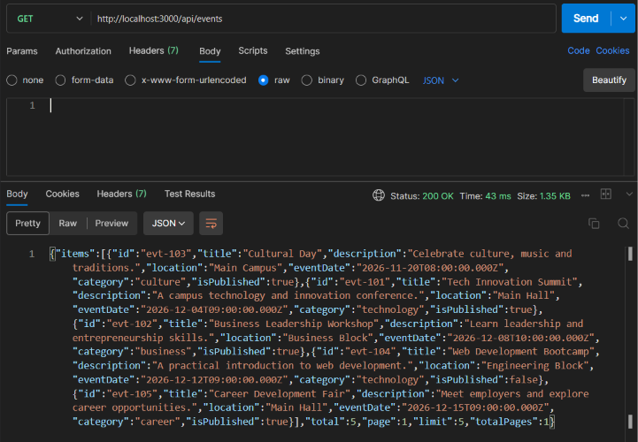
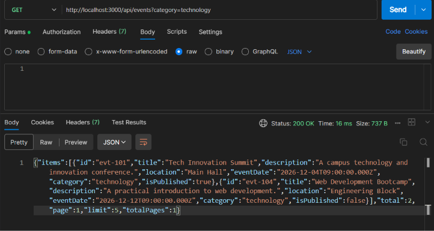
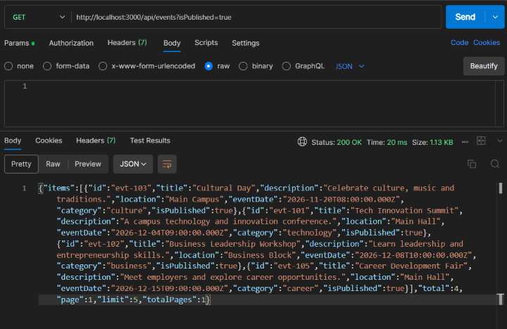
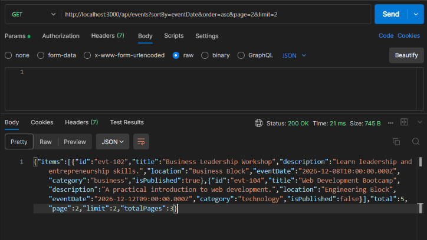
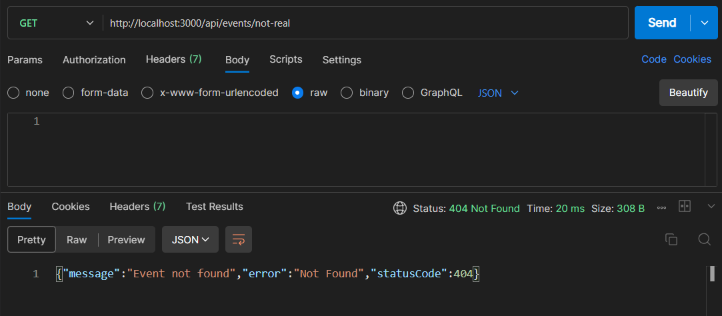
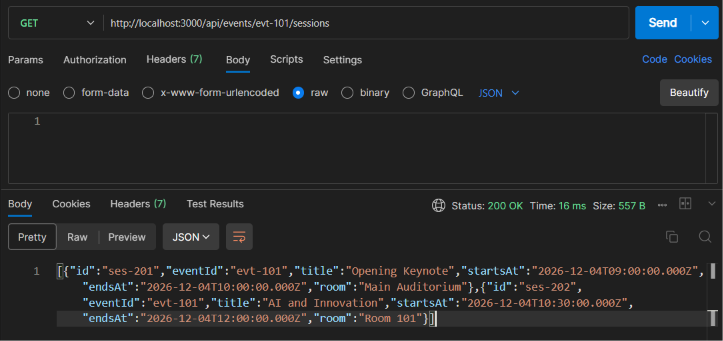
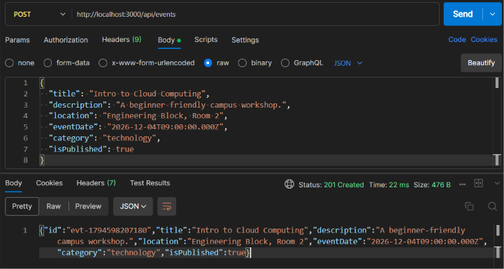
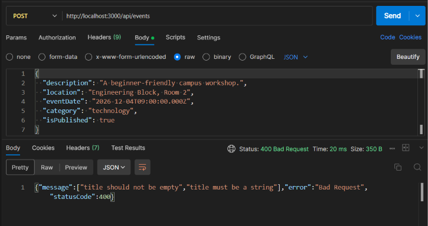

# Campus Events API

A RESTful API built with NestJS and TypeScript that allows students to discover campus events, view event details, and browse event sessions.

## Features

- Retrieve all campus events.
- Filter events by category, location, and publication status.
- Sort events by title or event date.
- Paginate event results.
- Retrieve upcoming events.
- Retrieve individual events by ID.
- View sessions belonging to an event.
- Create new events with request validation.
- Handle errors using appropriate HTTP status codes.

## Technologies

- NestJS
- TypeScript
- Node.js
- class-validator
- class-transformer

## Project Structure

```text
src/
├── events/
│   ├── dto/
│   │   ├── create-event.dto.ts
│   │   └── find-events-query.dto.ts
│   ├── events.controller.ts
│   ├── events.module.ts
│   ├── events.service.ts
│   └── events.types.ts
├── app.module.ts
└── main.ts
```

## Installation

Clone the repository:

```bash
git clone https://github.com/HelloSelam/codeops-portfolio/tree/master/module-04/day56/campus-events-api
```

Navigate into the project:

```bash
cd campus-events-api
```

Install dependencies:

```bash
npm install
```

## Running the Application

Start the development server:

```bash
npm run start:dev
```

The API runs at:

```text
http://localhost:3000/api
```

## API Endpoints

| Method | Endpoint | Description |
|---|---|---|
| GET | /api/events | Get all events |
| GET | /api/events/upcoming | Get upcoming events |
| GET | /api/events/:id | Get an event by ID |
| GET | /api/events/:id/sessions | Get sessions for an event |
| GET | /api/events/:id/sessions/:sessionId | Get a specific session |
| POST | /api/events | Create a new event |

## Filtering, Sorting and Pagination

The events endpoint supports optional query parameters.

| Parameter | Description | Example |
|---|---|---|
| category | Filter by category | category=technology |
| location | Filter by location | location=main |
| isPublished | Filter by publication status | isPublished=true |
| sortBy | Sort by title or eventDate | sortBy=eventDate |
| order | Ascending or descending | order=desc |
| page | Page number | page=2 |
| limit | Number of items per page | limit=3 |

Example:

```text
GET /api/events?category=technology&sortBy=eventDate&order=asc&page=1&limit=2
```

### Pagination Response

The API returns a consistent response containing:

- items: Events on the current page.
- total: Total matching events.
- page: Current page number.
- limit: Maximum items per page.
- totalPages: Total number of pages.

### Filtering and Sorting Logic

The service processes event data in three steps:

1. Filtering: Uses JavaScript's filter() method to select events matching the requested category, location, and publication status.
2. Sorting: Uses sort() on a copied array to arrange events by the selected field without modifying the original data.
3. Pagination: Uses slice() to return only the events belonging to the requested page.

The pagination offset is calculated using:

```typescript
const offset = (page - 1) * limit;
```

## Validation and HTTP Status Codes

The API uses DTOs and class-validator to validate incoming event data.

| Status | Meaning |
|---|---|
| 200 | Successful GET request |
| 201 | Event successfully created |
| 400 | Invalid request body or query parameters |
| 404 | Event or session not found |

## Testing

The API was tested using Postman.

Test coverage includes:

- Retrieving all events.
- Filtering and sorting events.
- Testing pagination.
- Retrieving upcoming events.
- Finding existing and missing events.
- Retrieving event sessions.
- Creating valid and invalid events.

### Test Evidence

The following screenshots demonstrate the API functionality tested using Postman.

#### 1. Get All Events


#### 2. Filter by Category


#### 3. Filter by Publication Status


#### 4. Sorting and Pagination


#### 5. Event Not Found


#### 6. Get Event Sessions


#### 7. Create Event


#### 8. Validation Error


## Data Storage

This project uses in-memory arrays for storing events and sessions. No external database is required.

Data created through POST requests is temporary and resets when the application restarts.

## Author

Selamawit Yeruk

CodeOps Backend Development — Day 56 Practical Exercise